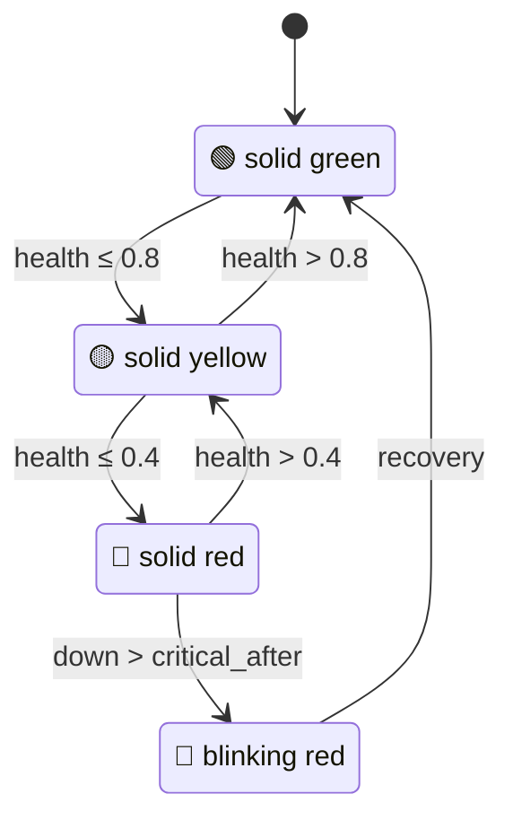

# luxafor

> Python driver and internet health monitor for the Luxafor Flag USB LED device.

[](https://www.python.org/downloads/)
[](https://github.com/joeblackwaslike/luxafor/blob/main/LICENSE)
[](https://github.com/joeblackwaslike/luxafor/actions/workflows/main.yml?query=branch%3Amain)

Your [Luxafor Flag](https://luxafor.com/luxafor-flag/) is a $30 USB LED that blinks when you get a notification. This package turns it into a real-time internet health indicator — green when connectivity is solid, yellow when it degrades, red when it drops, blinking red when it's been down long enough to page someone.



## Install

```bash
git clone https://github.com/joeblackwaslike/luxafor.git
cd luxafor
uv sync
```

## What you get

- **HID driver** — direct USB control of the Luxafor Flag via `hid` (vendor `0x04D8`, product `0xF372`), no official app required.
- **Internet monitor** — concurrent TCP probes to `8.8.8.8`, `1.1.1.1`, and `9.9.9.9` with weighted health scoring, 3-second hysteresis, anomaly detection, and automatic LED updates.
- **Webhook client** — async `httpx` client for the Luxafor remote webhook API.

## Quick start

Set the flag to a specific color:

```bash
luxafor set-color red
```

Start the internet health monitor:

```bash
luxafor monitor
```

The monitor runs continuously, probing DNS resolvers every 1.5 seconds and mapping the weighted health score to an LED color. Use `--critical-after` / `-c` to set how many seconds of downtime before the flag starts blinking red (default: 300s):

```bash
luxafor monitor --critical-after 60
```

## How the monitor works

Each probe round opens TCP connections to three public DNS resolvers concurrently with a 2-second timeout. Results feed a sliding window of 20 samples, weighted toward recency.

| Health score | Status | LED |
|---|---|---|
| > 0.8 | Healthy | 🟢 Green |
| 0.4 – 0.8 | Degraded | 🟡 Yellow |
| ≤ 0.4 | Down | 🔴 Red |
| Down > threshold | Critical | 🔴 Blinking red |

State transitions require 3 seconds of sustained change (hysteresis) to avoid flicker. If a single probe fails amid otherwise healthy traffic, the flag flashes cyan briefly (anomaly detection) but doesn't change state.

## HID protocol

The Luxafor Flag communicates over 8-byte HID reports:

```
Byte 0: Report ID (0x00)
Byte 1: Reserved (0x00)
Byte 2: Color code (ASCII: R=0x52, G=0x47, B=0x42, ...)
Byte 3–7: Reserved (0x00)
```

Available colors: `off`, `red`, `green`, `blue`, `cyan`, `magenta`, `yellow`, `white`.

## Project structure

```
src/luxafor/
├── __main__.py      # Typer CLI (set-color, monitor)
├── monitor.py       # Internet health monitor
├── util.py          # Loguru logger setup
├── local/
│   ├── __init__.py  # Exports FlagColor, HIDBuffer, LuxaforFlag
│   └── _hid.py      # USB HID driver
└── remote/
    ├── __init__.py   # Exports FlagColor, RemoteWebhookFlag
    └── webhook.py    # Async webhook client
```

## Configuration

The monitor uses sensible defaults with no config file required:

| Parameter | Default | Description |
|---|---|---|
| Probe targets | `8.8.8.8:53`, `1.1.1.1:53`, `9.9.9.9:53` | DNS resolvers to probe |
| Probe interval | 1.5s | Time between probe rounds |
| Probe timeout | 2.0s | TCP connect timeout per target |
| Window size | 20 | Sliding window of samples |
| Hysteresis | 3.0s | Required duration before state change |
| Critical after | 300s | Seconds of downtime before blinking red |
| Blink interval | 0.5s | Critical-state blink rate |

Override `--critical-after` via the CLI. Other parameters are module constants in [monitor.py](src/luxafor/monitor.py).

## Running as a background service (macOS)

Create a LaunchAgent to run the monitor persistently:

```bash
cat > ~/Library/LaunchAgents/com.luxafor.monitor.plist << 'EOF'
<?xml version="1.0" encoding="UTF-8"?>
<!DOCTYPE plist PUBLIC "-//Apple//DTD PLIST 1.0//EN" "http://www.apple.com/DTDs/PropertyList-1.0.dtd">
<plist version="1.0">
<dict>
    <key>Label</key>
    <string>com.luxafor.monitor</string>
    <key>ProgramArguments</key>
    <array>
        <string>/path/to/your/venv/bin/luxafor</string>
        <string>monitor</string>
    </array>
    <key>RunAtLoad</key>
    <true/>
    <key>KeepAlive</key>
    <true/>
</dict>
</plist>
EOF

launchctl load ~/Library/LaunchAgents/com.luxafor.monitor.plist
```

## Development

```bash
uv sync
uv run pytest tests/ -v
uv run ruff check .
uv run mypy
```

## License

[MIT](LICENSE)
