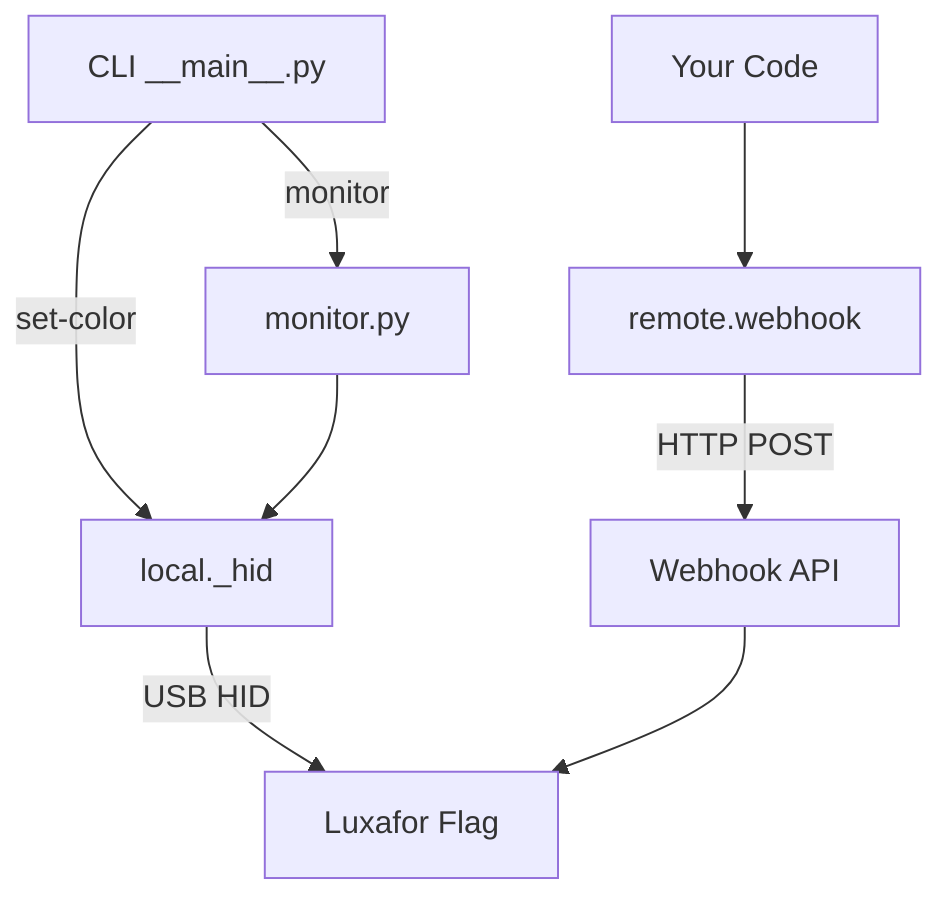
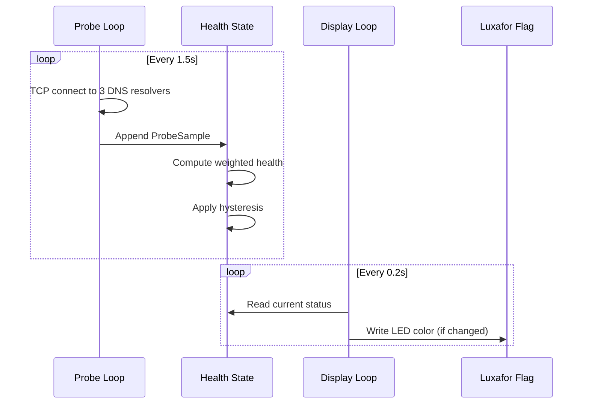

# Architecture

## Package structure

```
src/luxafor/
├── __init__.py
├── __main__.py      # Typer CLI entry point
├── monitor.py       # InternetMonitor + probe logic
├── util.py          # Loguru logger setup
├── local/
│   ├── __init__.py  # Re-exports FlagColor, HIDBuffer, LuxaforFlag
│   └── _hid.py      # USB HID driver
└── remote/
    ├── __init__.py   # Re-exports FlagColor, RemoteWebhookFlag
    └── webhook.py    # Async HTTP webhook client
```

## Two control paths



### Local path (USB HID)

The `local` subpackage communicates directly with the Luxafor Flag over USB. The flow:

1. `LuxaforFlag.__init__()` opens the HID device via `hid.Device(0x04D8, 0xF372)`
2. `set_color()` constructs an `HIDBuffer` (8-byte report) with the color code at byte 2
3. The buffer is written to the device via `device.write()`

This path is used by both the `set-color` CLI command and the internet monitor.

### Remote path (HTTP webhook)

The `remote` subpackage communicates over HTTP to the Luxafor webhook API:

1. `RemoteWebhookFlag.__init__()` builds the base URL with `furl`
2. `solid_color()` POSTs a JSON payload to `/webhook/v1/actions/solid_color`
3. The webhook server forwards the command to the device

This path is for controlling devices that aren't directly connected via USB.

## Monitor design

The `InternetMonitor` is a dataclass with two concurrent async loops:



Key design decisions:

- **Decoupled loops** — probing and display run independently, so a slow probe doesn't delay LED updates
- **Hysteresis** — state transitions require 3 seconds of sustained change to prevent flicker
- **Anomaly detection** — single-probe failures amid healthy traffic flash cyan without changing state
- **Redundant write suppression** — the display loop tracks the last color written and skips HID writes when nothing changed
- **Graceful degradation** — all HID errors are caught; a disconnected device triggers automatic reconnection on the next write

## Logging

All modules use `loguru` via `util.setup_logger()`. Logging is:

- Structured (JSON serialized)
- Async-safe (`enqueue=True`)
- Output to stdout at INFO level
- Includes full backtraces on errors
