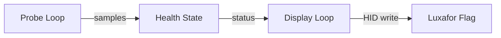
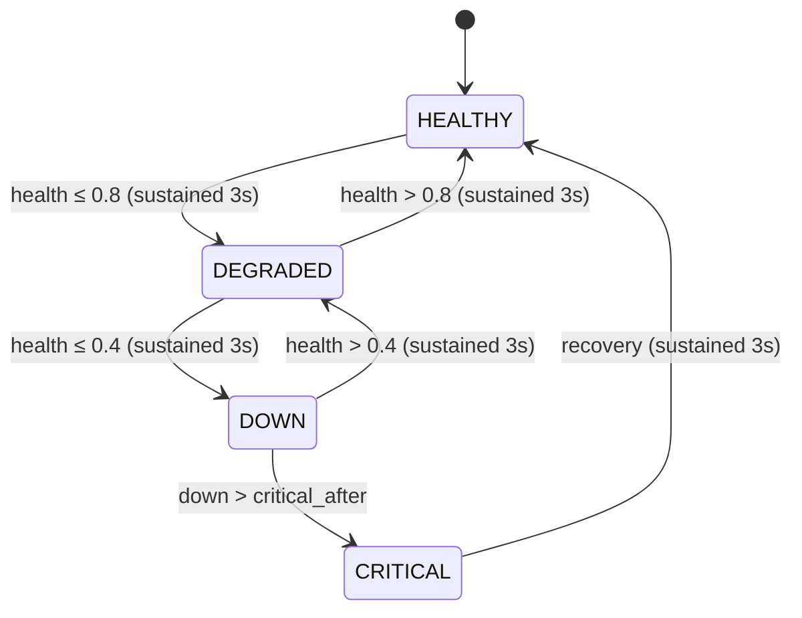

# Internet Health Monitor

The monitor is the core feature of luxafor. It turns the Luxafor Flag into a real-time visual indicator of your internet connectivity.

## Architecture

The monitor runs two concurrent async loops:



- **Probe loop** — TCP-connects to DNS resolvers every 1.5 seconds, updates the health state
- **Display loop** — reads the current state every 0.2 seconds, writes the appropriate color to the LED

Both loops run concurrently in an `anyio` task group.

## Probing

Each round opens concurrent TCP connections to three public DNS resolvers:

| Target | Port | Service |
|---|---|---|
| `8.8.8.8` | 53 | Google Public DNS |
| `1.1.1.1` | 53 | Cloudflare DNS |
| `9.9.9.9` | 53 | Quad9 DNS |

Each probe has a 2-second timeout. A successful TCP connect counts as a success; a timeout or connection error counts as a failure. The result is stored as a `ProbeSample` with the number of successes out of the total probes.

## Health scoring

The health score is a weighted average of the most recent 20 samples, biased toward recency. Newer samples carry more weight:

```
score = Σ(weight_i × success_rate_i) / Σ(weight_i)
where weight_i = 1 + index  (index 0 = oldest)
```

This means a recent failure has more impact than an old one, and recovery is reflected quickly.

## State machine

The monitor tracks four states:



All transitions (except DOWN → CRITICAL) require 3 seconds of hysteresis — the suggested new state must persist for 3 continuous seconds before the actual state changes. This prevents LED flicker from transient packet loss.

The CRITICAL state is escalated automatically when the flag has been in DOWN state longer than the `critical_after` threshold (default: 300 seconds).

## Anomaly detection

If a probe round has failures while the current state is HEALTHY and the last three rounds were all clean, the monitor detects this as an anomaly. Instead of changing state, it flashes the LED **cyan** for 0.6 seconds as a visual blip. This catches one-off packet loss without triggering a full state change.

## LED color mapping

| Status | Color | Behavior |
|---|---|---|
| HEALTHY | Green (`0x47`) | Solid |
| DEGRADED | Yellow (`0x59`) | Solid |
| DOWN | Red (`0x52`) | Solid |
| CRITICAL | Red (`0x52`) / Off (`0x4F`) | Alternating every 0.5 seconds |
| Anomaly | Cyan (`0x43`) | Flash for 0.6 seconds |

The display loop skips redundant HID writes — if the color hasn't changed, no write is sent.

## Configuration constants

These are module-level constants in `monitor.py`:

| Constant | Value | Purpose |
|---|---|---|
| `PROBE_TARGETS` | 3 DNS resolvers | Targets for TCP probes |
| `PROBE_INTERVAL` | 1.5s | Time between probe rounds |
| `PROBE_TIMEOUT` | 2.0s | TCP connect timeout |
| `WINDOW_SIZE` | 20 | Sliding window for health scoring |
| `HYSTERESIS_SECONDS` | 3.0s | Required sustained duration for state changes |
| `BLINK_INTERVAL` | 0.5s | Critical-state blink rate |
| `DISPLAY_TICK` | 0.2s | Display loop update interval |
| `ANOMALY_FLASH_DURATION` | 0.6s | Cyan flash duration for anomalies |
