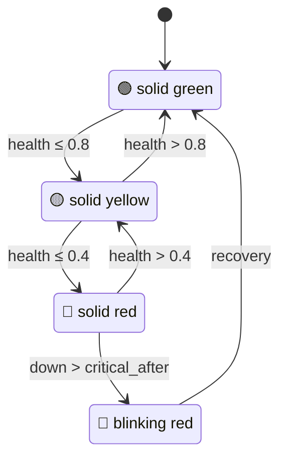

# luxafor

Python driver and internet health monitor for the Luxafor Flag USB LED device.

The [Luxafor Flag](https://luxafor.com/luxafor-flag/) is a USB-connected RGB LED indicator. This package provides:

- **Direct HID control** — set colors over USB without the official Luxafor app
- **Internet health monitor** — real-time connectivity status mapped to LED colors
- **Webhook client** — async HTTP client for the Luxafor remote API
- **CLI** — Typer-based command-line interface for both features

## How the monitor works

The monitor continuously probes three public DNS resolvers (`8.8.8.8`, `1.1.1.1`, `9.9.9.9`) via TCP and maps the weighted health score to LED colors:



State transitions use a 3-second hysteresis to prevent LED flicker from transient packet loss.

## Quick example

```bash
# Set the flag to red
luxafor set-color red

# Start the internet health monitor
luxafor monitor

# Alert after 60 seconds of downtime instead of the default 300
luxafor monitor --critical-after 60
```

## Next steps

- [Installation](./installation) — get the package running
- [Getting Started](./getting-started) — first commands and setup
- [Monitor Guide](./guides/monitor) — deep dive into the health monitor
- [HID Protocol](./guides/hid-protocol) — low-level USB communication details
